# 基于小程序的物流管理系统---论文

> 🎓 **计算机毕业设计 · 基于小程序的物流管理系统---论文**
>
> 本仓库只放**项目介绍 + 运行截图**（截图是站点带水印的原图，存在仓库 `images/` 里）。
>
> 👉 **完整可运行源码 / 数据库脚本 / 部署文档：[点我获取](https://geekcode.top/archives/%E5%9F%BA%E4%BA%8E%E5%B0%8F%E7%A8%8B%E5%BA%8F%E7%9A%84%E7%89%A9%E6%B5%81%E7%AE%A1%E7%90%86%E7%B3%BB%E7%BB%9F-%E8%AE%BA%E6%96%87?utm_source=github)**
>
> 💬 咨询微信：**ir9372**　|　🌐 更多项目：[极客代码 geekcode.top](https://geekcode.top/?utm_source=github)
>
> 📌 项目详情页：<https://geekcode.top/archives/%E5%9F%BA%E4%BA%8E%E5%B0%8F%E7%A8%8B%E5%BA%8F%E7%9A%84%E7%89%A9%E6%B5%81%E7%AE%A1%E7%90%86%E7%B3%BB%E7%BB%9F-%E8%AE%BA%E6%96%87?utm_source=github>

<table><td width="230" align="center"> <b>扫码加微信 ir9372</b></td><td valign="middle">📦 源码 = 项目介绍 + 全部运行截图 + 数据库 + 部署文档 👉 点上方任意截图，直接跳到 <b>极客代码 geekcode.top</b> 详情页</td></table>

---

<h1>基于小程序的物流管理系统---论文</h1>
<h2>项目概述</h2>

本项目名为“基于小程序的物流管理系统”，旨在构建一个集移动端便捷服务与后台高效管理于一体的综合性物流业务平台。系统核心功能涵盖物流公司信息管理、物品分类维护、运输配送全流程监控、仓储及装卸搬运记录以及物流资讯发布等模块。适用人群包括需要查询物流状态、管理个人信息的普通用户，以及负责企业运营、员工调度及数据审核的管理员。技术架构上，前端采用微信小程序提供轻量级交互体验，后端基于 Java Spring Boot 框架结合 MyBatis-Plus 实现持久层操作，并通过 Apache Shiro 保障系统安全。该项目通过 RESTful API 实现前后端分离的数据交互，有效解决了传统物流管理中信息滞后、流程不透明的问题，提升了物流企业的运营效率与服务响应速度。

<h2>技术架构</h2>

本系统采用典型的前后端分离架构设计，确保系统的可扩展性与维护性。

<strong>1. 前端架构（微信小程序）</strong>
前端使用微信原生开发框架或兼容的小程序开发语言构建用户界面。小程序端作为主要的数据展示与交互入口，负责渲染物流列表、详情页面及管理后台视图。通过 <code>wx.request</code> 发起 HTTP 请求，以 JSON 格式与后端进行数据交换。

<strong>2. 后端架构（Java Spring Boot）</strong>
后端基于 Spring Boot 框架构建，利用其自动配置特性快速搭建 Web 应用。具体技术选型如下：

<ul>
<li><strong>Web 层</strong>: 使用 <code>spring-boot-starter-web</code> 处理 HTTP 请求，定义 RESTful 接口。</li>
<li><strong>持久层</strong>: 集成 <code>mybatis-spring-boot-starter</code> 和 <code>mybatis-plus</code>，简化 SQL 编写并增强 CRUD 操作能力；数据库连接池由 <code>spring-boot-starter-jdbc</code> 管理。</li>
<li><strong>安全层</strong>: 引入 <code>shiro-spring</code> 实现身份认证与权限控制，保护敏感接口。</li>
<li><strong>工具类</strong>: 使用 <code>commons-lang3</code> 处理字符串与通用逻辑，<code>validation-api</code> 用于参数校验。</li>
</ul>

<strong>3. 数据库设计要点</strong>
数据存储于 MySQL 数据库中，通过 <code>mysql-connector-java</code> 驱动进行连接。根据 Controller 列表推断，数据库表结构至少包含以下核心实体：

<ul>
<li><strong>基础信息表</strong>: <code>wuliugongsi</code> (物流公司), <code>bumen</code> (部门), <code>yuangong</code> (员工), <code>yonghu</code> (用户)。</li>
<li><strong>业务流程表</strong>: <code>yunshuxinxi</code> (运输信息), <code>peisongxinxi</code> (配送信息), <code>cangchuxinxi</code> (仓储信息), <code>zhuangxiebanyun</code> (装卸搬运), <code>shouhuoxinxi</code> (收货信息)。</li>
<li><strong>内容与配置表</strong>: <code>news</code> (物流资讯), <code>aboutus</code> (关于我们), <code>systemintro</code> (系统简介), <code>config</code> (系统配置), <code>wupinfenlei</code> (物品分类)。</li>
</ul>

<strong>4. 交互方式</strong>
小程序前端与 Java 后端通过标准的 REST API 进行通信。所有业务逻辑均在服务端执行，前端仅负责数据的获取与展示，确保了业务规则的一致性和安全性。

<a href="https://geekcode.top/archives/%E5%9F%BA%E4%BA%8E%E5%B0%8F%E7%A8%8B%E5%BA%8F%E7%9A%84%E7%89%A9%E6%B5%81%E7%AE%A1%E7%90%86%E7%B3%BB%E7%BB%9F-%E8%AE%BA%E6%96%87?utm_source=github" title="查看完整源码">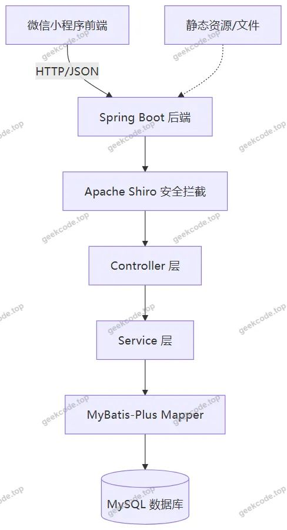</a>

<h2>功能模块</h2>

根据提供的路由、Controller 列表及截图信息，系统功能划分为小程序用户端与 Web 后台管理端两部分。

<h3>1. 小程序用户端功能</h3>

小程序端主要面向普通用户及内部管理人员，提供物流信息查询及个人管理服务。

<ul>
<li><strong>账户体系</strong>:</li>
<li><strong>登录/注册</strong>: 支持用户账号密码登录及新用户注册。</li>
<li><strong>个人中心</strong>: 查看及修改个人信息（如头像、昵称、联系方式）。</li>
<li><strong>物流信息查询</strong>:</li>
<li><strong>物流信息列表</strong>: 展示综合物流动态。</li>
<li><strong>运输信息列表</strong>: 查看货物在途运输状态。</li>
<li><strong>配送信息列表</strong>: 追踪末端配送进度。</li>
<li><strong>仓储信息列表</strong>: 查询货物存储位置及状态。</li>
<li><strong>装卸搬运列表</strong>: 查看仓库内的作业记录。</li>
<li><strong>收货信息列表</strong>: 确认收货状态及相关凭证。</li>
<li><strong>企业与资讯</strong>:</li>
<li><strong>物流公司</strong>: 展示合作或所属物流公司的基本信息。</li>
<li><strong>物流资讯</strong>: 浏览行业新闻或公司公告 (<code>/news</code>)。</li>
<li><strong>关于我们</strong>: 查看系统或公司简介 (<code>/aboutus</code>)。</li>
<li><strong>支付相关</strong>:</li>
<li><strong>PayConfirm</strong>: 存在支付确认页面，暗示系统具备费用结算或订单支付功能。</li>
</ul>
<h3>2. Web 后台管理端功能</h3>

Web 后台主要供管理员使用，侧重于基础数据维护、人员管理及系统配置。

<ul>
<li><strong>基础数据管理</strong>:</li>
<li><strong>物流公司管理</strong>: 增删改查物流企业档案 (<code>/wuliugongsi</code>)。</li>
<li><strong>物品分类管理</strong>: 维护物流货物的类别体系 (<code>/wupinfenlei</code>)。</li>
<li><strong>部门管理</strong>: 设置企业内部组织架构 (<code>/bumen</code>)。</li>
<li><strong>员工管理</strong>: 录入和维护员工基本信息 (<code>/yuangong</code>)。</li>
<li><strong>用户管理</strong>: 管理平台注册用户 (<code>/yonghu</code>)。</li>
<li><strong>业务信息管理</strong>:</li>
<li><strong>运输信息管理</strong>: 审核或录入运输单据 (<code>/yunshuxinxi</code>)。</li>
<li><strong>配送信息管理</strong>: 管理配送任务数据 (<code>/peisongxinxi</code>)。</li>
<li><strong>仓储信息管理</strong>: 维护库存及仓库数据 (<code>/cangchuxinxi</code>)。</li>
<li><strong>装卸搬运管理</strong>: 记录搬运作业情况 (<code>/zhuangxiebanyun</code>)。</li>
<li><strong>收货信息管理</strong>: 处理收货确认数据 (<code>/shouhuoxinxi</code>)。</li>
<li><strong>内容与系统配置</strong>:</li>
<li><strong>物流资讯管理</strong>: 发布和管理新闻公告 (<code>/news</code>)。</li>
<li><strong>关于我们管理</strong>: 编辑公司介绍文案 (<code>/aboutus</code>)。</li>
<li><strong>系统简介管理</strong>: 配置系统说明文档 (<code>/systemintro</code>)。</li>
<li><strong>系统配置</strong>: 修改全局参数 (<code>/config</code>)。</li>
<li><strong>文件管理</strong>: 上传和管理系统所需的图片、文档等资源 (<code>FileController</code>)。</li>
</ul>
<h2>用户角色与权限</h2>

系统基于 Apache Shiro 实现细粒度的权限控制，主要划分为两类核心角色，分别对应不同的访问入口和操作权限。

<strong>1. 普通用户 (User)</strong>

<ul>
<li><strong>访问端</strong>: 微信小程序前端。</li>
<li><strong>权限范围</strong>:</li>
<li><strong>数据查看</strong>: 拥有对自己关联的物流单号、运输状态、配送进度、仓储位置等信息的只读权限。</li>
<li><strong>个人信息</strong>: 可以更新自己的个人资料（姓名、电话等），但无权修改后台管理的核心业务数据。</li>
<li><strong>资讯浏览</strong>: 可查看所有公开的物流资讯、公司信息及系统简介。</li>
<li><strong>支付操作</strong>: 若涉及运费结算，拥有发起支付和确认支付的权限。</li>
</ul>

<strong>2. 管理员 (Admin)</strong>

<ul>
<li><strong>访问端</strong>: Web 后台管理端 (部分高级管理功能可能同步至小程序“管理端”视图，如截图所示的“小程序-管理端-用户列表”)。</li>
<li><strong>权限范围</strong>:</li>
<li><strong>全量数据管理</strong>: 对所有业务表（物流公司、员工、部门、运输、配送、仓储等）拥有完整的 CRUD（增删改查）权限。</li>
<li><strong>内容发布</strong>: 有权发布、编辑或删除物流资讯、关于我们及系统简介等内容。</li>
<li><strong>用户管理</strong>: 可以禁用异常账号、重置用户密码或调整用户权限等级。</li>
<li><strong>系统配置</strong>: 拥有修改系统全局参数、上传配置文件及管理静态资源的最高权限。</li>
<li><strong>审计与监控</strong>: 可查看系统运行日志及关键业务操作记录。</li>
</ul>

<strong>权限隔离机制</strong>:
后端 Controller 通过 Shiro 注解或过滤器拦截请求，验证 Token 有效性及角色标识。普通用户的请求通常被限制在 <code>/user/*</code> 或特定业务查询接口，而管理操作则严格限定在 <code>/admin/*</code> 或具有 <code>roles=admin</code> 标记的接口中，防止越权访问。

<h2>项目特色与创新点</h2>

<strong>1. 多端协同的业务闭环</strong>
项目创新性地实现了“小程序 + Web 后台”的双端联动。小程序端侧重移动场景下的即时查询与信息触达，满足用户碎片化时间的使用需求；Web 后台则提供强大的数据录入与管理能力，适合办公场景下的高效操作。两者通过统一的 REST API 共享数据源，保证了信息的一致性。

<strong>2. 覆盖物流全链路的精细化管理</strong>
不同于简单的物流查询系统，本项目深入物流业务的各个细分环节。从基础的<strong>物品分类</strong>、<strong>物流公司</strong>入驻，到核心的<strong>运输</strong>、<strong>配送</strong>、<strong>仓储</strong>、<strong>装卸搬运</strong>及<strong>收货</strong>，形成了完整的业务链条映射。这种全链路的数字化管理有助于企业精准定位物流瓶颈，优化资源配置。

<strong>3. 基于 Shiro 的安全防护体系</strong>
在技术选型上，摒弃了简单的 Session 验证，引入了成熟的 Apache Shiro 框架。这不仅提供了可靠的身份认证（Authentication），还实现了灵活的授权（Authorization）机制。对于毕业设计而言，这体现了对系统安全性的高度重视，能够有效抵御常见的越权攻击和数据泄露风险。

<strong>4. 模块化与低耦合设计</strong>
后端采用 Spring Boot 结合 MyBatis-Plus 的标准分层架构，各 Controller 对应独立的业务领域（如 <code>CangchuxinxiController</code> 专管仓储，<code>PeisongxinxiController</code> 专管配送）。这种高内聚、低耦合的设计使得系统在后期扩展新功能（如增加冷链物流模块）时，无需重构核心代码，具备良好的可维护性。

<h2>部署环境</h2>

为确保系统正常运行，需准备以下软硬件环境：

<strong>1. 硬件环境</strong>

<ul>
<li><strong>服务器</strong>: CPU 2核及以上，内存 4GB 及以上，硬盘 50GB 可用空间。</li>
<li><strong>客户端</strong>: 智能手机（安装微信 App）或 PC 机（浏览器访问后台）。</li>
</ul>

<strong>2. 软件环境</strong>

<ul>
<li><strong>操作系统</strong>: Windows 10/11, macOS 或 Linux (CentOS 7+, Ubuntu 18+)。</li>
<li><strong>JDK</strong>: Java Development Kit 1.8 或以上版本（推荐 JDK 1.8，因 Spring Boot 版本兼容性较好）。</li>
<li><strong>数据库</strong>: MySQL 5.7 或 8.0 社区版/企业版。需初始化相应的 SQL 脚本以创建表结构及默认数据。</li>
<li><strong>Web 容器</strong>: 内置 Tomcat (由 spring-boot-starter-web 提供) 或独立部署的 Tomcat 9.x。</li>
<li><strong>构建工具</strong>: Maven 3.6+ 用于依赖管理和项目打包。</li>
</ul>

<strong>3. 前端开发工具</strong>

<ul>
<li><strong>微信开发者工具</strong>: 最新稳定版，用于小程序的代码编写、调试、预览及真机测试。</li>
<li><strong>Node.js</strong>: 虽然项目标记为 vue-integrated，但若小程序端使用了 npm 包管理，需安装 Node.js LTS 版本。</li>
</ul>

<strong>4. 其他依赖</strong>

<ul>
<li><strong>浏览器</strong>: Chrome, Edge, Firefox 等现代浏览器，用于访问 Web 后台管理界面。</li>
<li><strong>网络连接</strong>: 服务器需开放相应端口（默认为 8080 或自定义端口），并确保防火墙允许外部访问，以便小程序能成功调用后端 API。</li>
</ul>
<h2>五、技术特性</h2>
<ul>
<li>前后端集成部署，前端资源打包至后端 static 目录</li>
<li>使用 MyBatis-Plus 简化数据访问层开发</li>
<li>集成 Shiro 权限框架实现角色权限控制</li>
</ul>
<h2>六、功能模块截图</h2>
<h3>微信小程序用户端</h3>

<figure><figcaption>小程序-仓储信息列表</figcaption></figure>
<figure><a href="https://geekcode.top/archives/%E5%9F%BA%E4%BA%8E%E5%B0%8F%E7%A8%8B%E5%BA%8F%E7%9A%84%E7%89%A9%E6%B5%81%E7%AE%A1%E7%90%86%E7%B3%BB%E7%BB%9F-%E8%AE%BA%E6%96%87?utm_source=github" title="查看完整源码">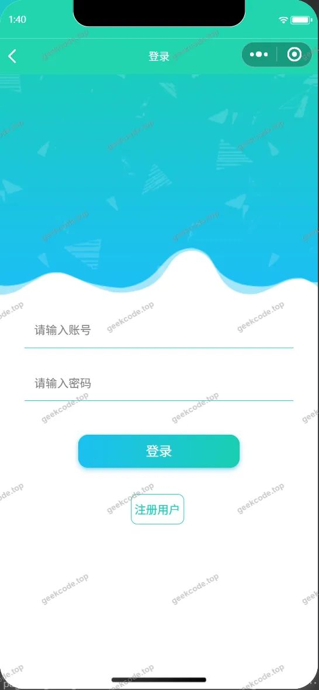</a><figcaption>小程序-登录</figcaption></figure>
<figure><a href="https://geekcode.top/archives/%E5%9F%BA%E4%BA%8E%E5%B0%8F%E7%A8%8B%E5%BA%8F%E7%9A%84%E7%89%A9%E6%B5%81%E7%AE%A1%E7%90%86%E7%B3%BB%E7%BB%9F-%E8%AE%BA%E6%96%87?utm_source=github" title="查看完整源码">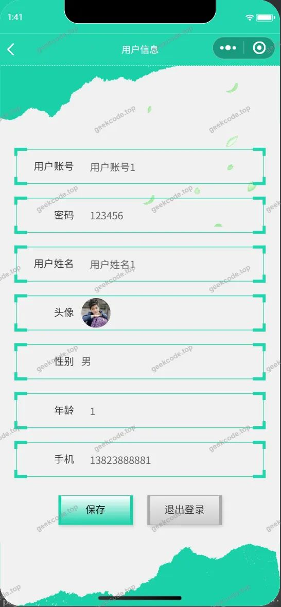</a><figcaption>小程序-个人信息</figcaption></figure>
<figure><figcaption>小程序-配送信息列表</figcaption></figure>
<figure><a href="https://geekcode.top/archives/%E5%9F%BA%E4%BA%8E%E5%B0%8F%E7%A8%8B%E5%BA%8F%E7%9A%84%E7%89%A9%E6%B5%81%E7%AE%A1%E7%90%86%E7%B3%BB%E7%BB%9F-%E8%AE%BA%E6%96%87?utm_source=github" title="查看完整源码">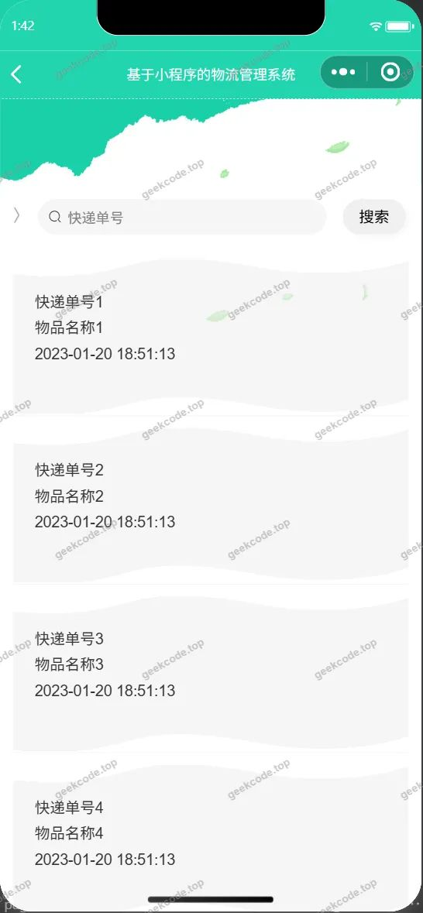</a><figcaption>小程序-收货信息列表</figcaption></figure>
<figure><figcaption>小程序-首页</figcaption></figure>
<figure><a href="https://geekcode.top/archives/%E5%9F%BA%E4%BA%8E%E5%B0%8F%E7%A8%8B%E5%BA%8F%E7%9A%84%E7%89%A9%E6%B5%81%E7%AE%A1%E7%90%86%E7%B3%BB%E7%BB%9F-%E8%AE%BA%E6%96%87?utm_source=github" title="查看完整源码">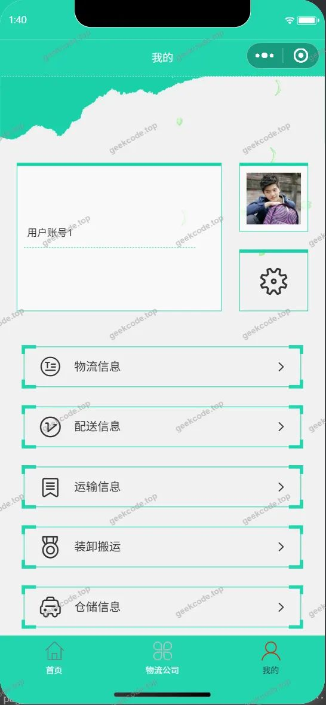</a><figcaption>小程序-我的</figcaption></figure>
<figure><a href="https://geekcode.top/archives/%E5%9F%BA%E4%BA%8E%E5%B0%8F%E7%A8%8B%E5%BA%8F%E7%9A%84%E7%89%A9%E6%B5%81%E7%AE%A1%E7%90%86%E7%B3%BB%E7%BB%9F-%E8%AE%BA%E6%96%87?utm_source=github" title="查看完整源码">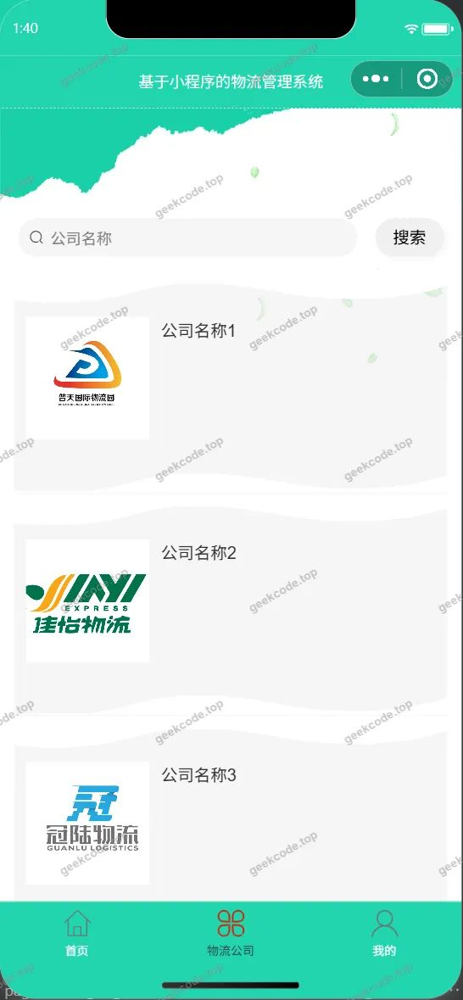</a><figcaption>小程序-物流公司</figcaption></figure>
<figure><figcaption>小程序-物流信息列表</figcaption></figure>
<figure><figcaption>小程序-运输信息列表</figcaption></figure>
<figure><a href="https://geekcode.top/archives/%E5%9F%BA%E4%BA%8E%E5%B0%8F%E7%A8%8B%E5%BA%8F%E7%9A%84%E7%89%A9%E6%B5%81%E7%AE%A1%E7%90%86%E7%B3%BB%E7%BB%9F-%E8%AE%BA%E6%96%87?utm_source=github" title="查看完整源码">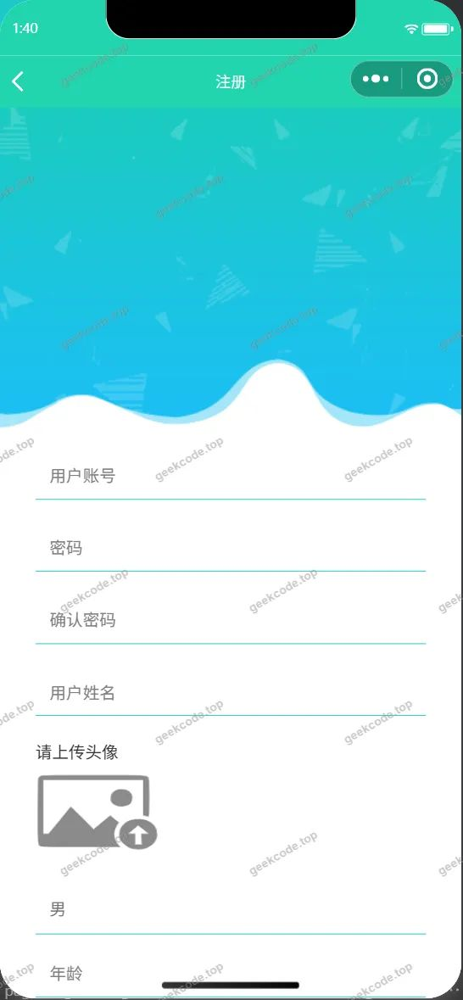</a><figcaption>小程序-注册</figcaption></figure>
<figure><figcaption>小程序-装卸搬运列表</figcaption></figure>
<figure><a href="https://geekcode.top/archives/%E5%9F%BA%E4%BA%8E%E5%B0%8F%E7%A8%8B%E5%BA%8F%E7%9A%84%E7%89%A9%E6%B5%81%E7%AE%A1%E7%90%86%E7%B3%BB%E7%BB%9F-%E8%AE%BA%E6%96%87?utm_source=github" title="查看完整源码">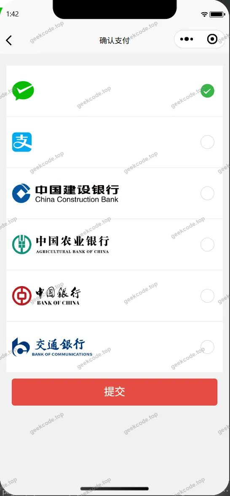</a><figcaption>小程序-payconfirm</figcaption></figure>

<h3>微信小程序管理端</h3>

<figure><a href="https://geekcode.top/archives/%E5%9F%BA%E4%BA%8E%E5%B0%8F%E7%A8%8B%E5%BA%8F%E7%9A%84%E7%89%A9%E6%B5%81%E7%AE%A1%E7%90%86%E7%B3%BB%E7%BB%9F-%E8%AE%BA%E6%96%87?utm_source=github" title="查看完整源码">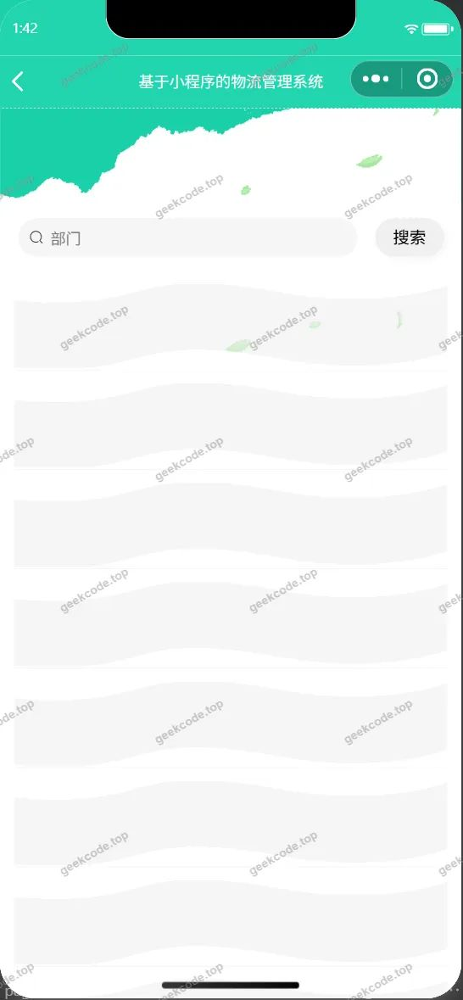</a><figcaption>小程序-管理端-部门列表</figcaption></figure>
<figure><figcaption>小程序-管理端-关于我们列表</figcaption></figure>
<figure><a href="https://geekcode.top/archives/%E5%9F%BA%E4%BA%8E%E5%B0%8F%E7%A8%8B%E5%BA%8F%E7%9A%84%E7%89%A9%E6%B5%81%E7%AE%A1%E7%90%86%E7%B3%BB%E7%BB%9F-%E8%AE%BA%E6%96%87?utm_source=github" title="查看完整源码">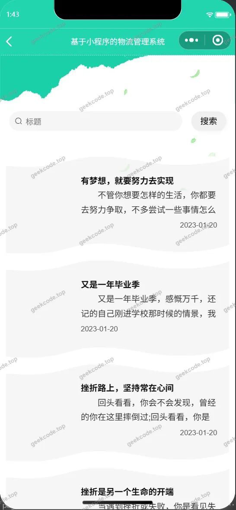</a><figcaption>小程序-管理端-物流资讯列表</figcaption></figure>
<figure><a href="https://geekcode.top/archives/%E5%9F%BA%E4%BA%8E%E5%B0%8F%E7%A8%8B%E5%BA%8F%E7%9A%84%E7%89%A9%E6%B5%81%E7%AE%A1%E7%90%86%E7%B3%BB%E7%BB%9F-%E8%AE%BA%E6%96%87?utm_source=github" title="查看完整源码">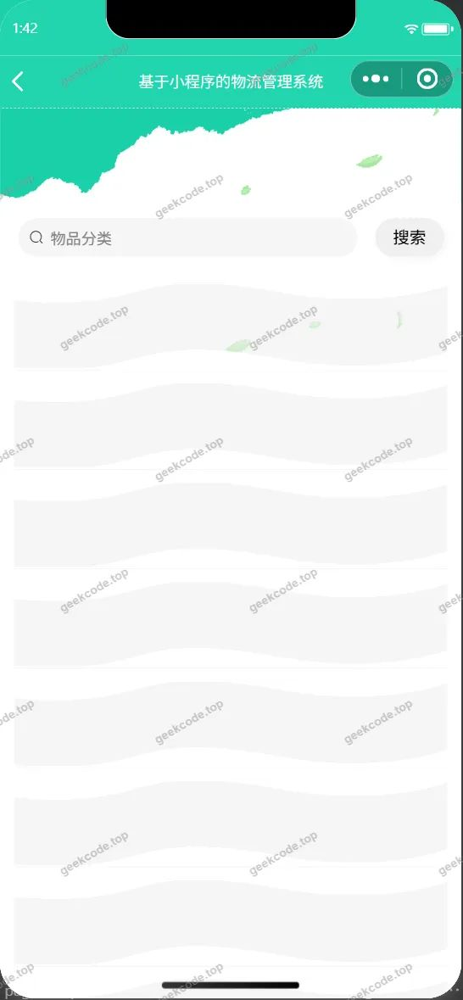</a><figcaption>小程序-管理端-物品分类列表</figcaption></figure>
<figure><a href="https://geekcode.top/archives/%E5%9F%BA%E4%BA%8E%E5%B0%8F%E7%A8%8B%E5%BA%8F%E7%9A%84%E7%89%A9%E6%B5%81%E7%AE%A1%E7%90%86%E7%B3%BB%E7%BB%9F-%E8%AE%BA%E6%96%87?utm_source=github" title="查看完整源码">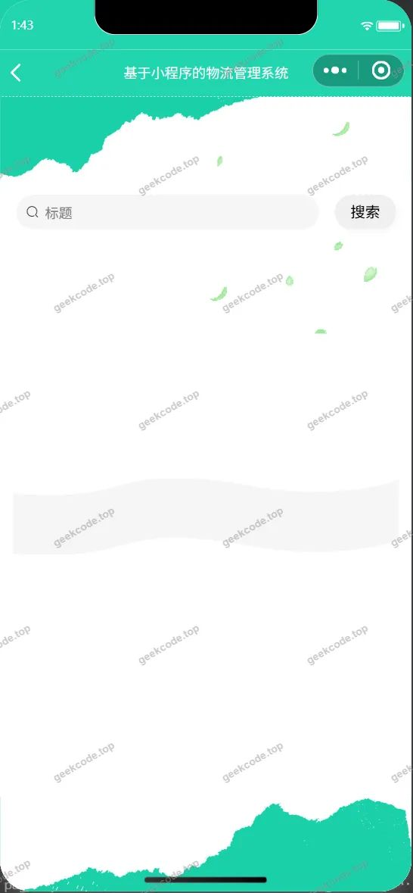</a><figcaption>小程序-管理端-系统简介列表</figcaption></figure>
<figure><figcaption>小程序-管理端-用户列表</figcaption></figure>
<figure><a href="https://geekcode.top/archives/%E5%9F%BA%E4%BA%8E%E5%B0%8F%E7%A8%8B%E5%BA%8F%E7%9A%84%E7%89%A9%E6%B5%81%E7%AE%A1%E7%90%86%E7%B3%BB%E7%BB%9F-%E8%AE%BA%E6%96%87?utm_source=github" title="查看完整源码">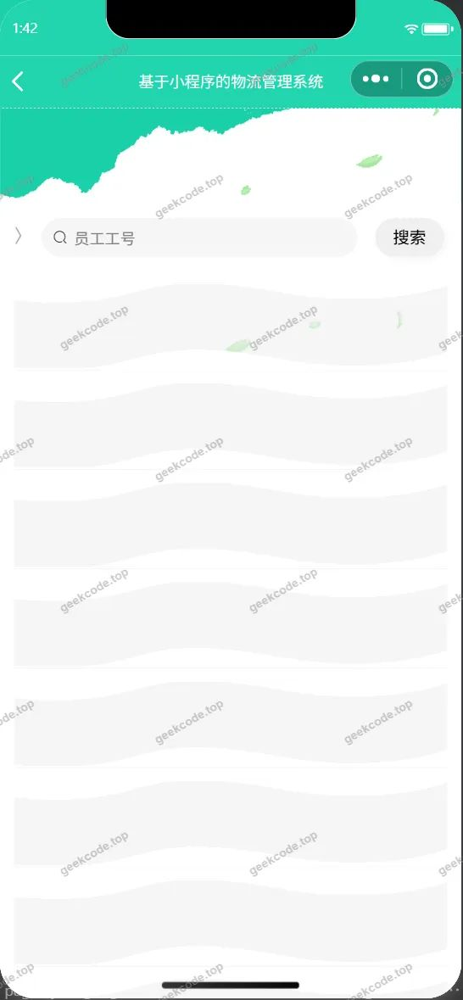</a><figcaption>小程序-管理端-员工列表</figcaption></figure>

<h3>后台管理端</h3>
<h4>后台-登录页</h4>

<h4>后台-关于我们</h4>

<a href="https://geekcode.top/archives/%E5%9F%BA%E4%BA%8E%E5%B0%8F%E7%A8%8B%E5%BA%8F%E7%9A%84%E7%89%A9%E6%B5%81%E7%AE%A1%E7%90%86%E7%B3%BB%E7%BB%9F-%E8%AE%BA%E6%96%87?utm_source=github" title="查看完整源码">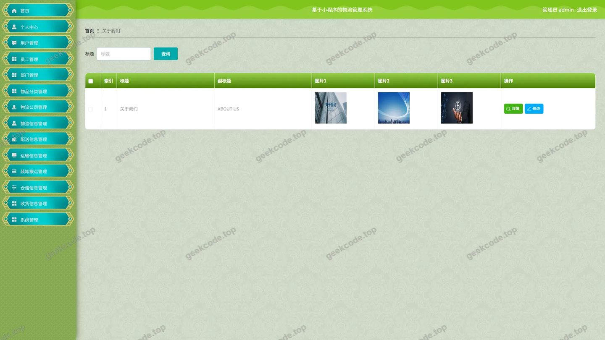</a>

<h4>后台-配送信息</h4>

<a href="https://geekcode.top/archives/%E5%9F%BA%E4%BA%8E%E5%B0%8F%E7%A8%8B%E5%BA%8F%E7%9A%84%E7%89%A9%E6%B5%81%E7%AE%A1%E7%90%86%E7%B3%BB%E7%BB%9F-%E8%AE%BA%E6%96%87?utm_source=github" title="查看完整源码">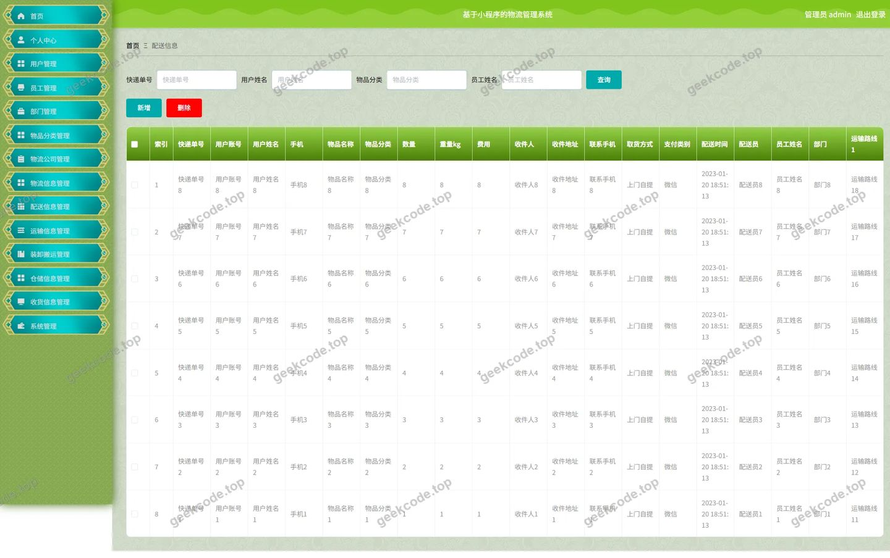</a>

<h4>后台首页</h4>

<a href="https://geekcode.top/archives/%E5%9F%BA%E4%BA%8E%E5%B0%8F%E7%A8%8B%E5%BA%8F%E7%9A%84%E7%89%A9%E6%B5%81%E7%AE%A1%E7%90%86%E7%B3%BB%E7%BB%9F-%E8%AE%BA%E6%96%87?utm_source=github" title="查看完整源码">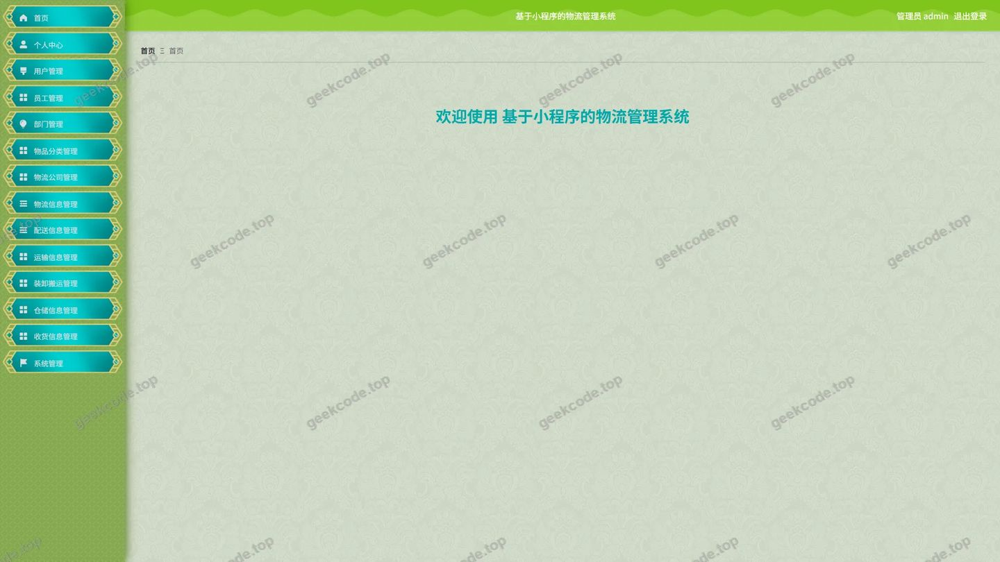</a>

<h4>后台-物流资讯</h4>

<a href="https://geekcode.top/archives/%E5%9F%BA%E4%BA%8E%E5%B0%8F%E7%A8%8B%E5%BA%8F%E7%9A%84%E7%89%A9%E6%B5%81%E7%AE%A1%E7%90%86%E7%B3%BB%E7%BB%9F-%E8%AE%BA%E6%96%87?utm_source=github" title="查看完整源码">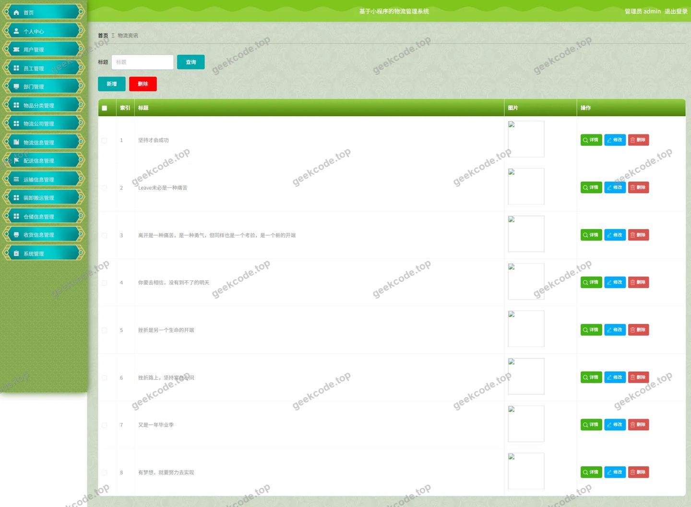</a>

<h4>后台-物品分类</h4>

<a href="https://geekcode.top/archives/%E5%9F%BA%E4%BA%8E%E5%B0%8F%E7%A8%8B%E5%BA%8F%E7%9A%84%E7%89%A9%E6%B5%81%E7%AE%A1%E7%90%86%E7%B3%BB%E7%BB%9F-%E8%AE%BA%E6%96%87?utm_source=github" title="查看完整源码">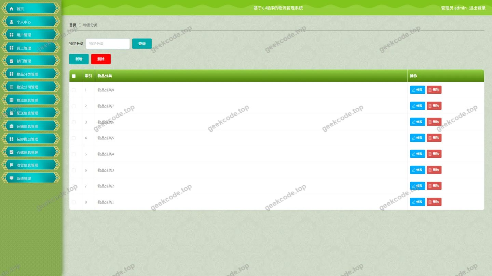</a>

<h4>后台-员工</h4>

<a href="https://geekcode.top/archives/%E5%9F%BA%E4%BA%8E%E5%B0%8F%E7%A8%8B%E5%BA%8F%E7%9A%84%E7%89%A9%E6%B5%81%E7%AE%A1%E7%90%86%E7%B3%BB%E7%BB%9F-%E8%AE%BA%E6%96%87?utm_source=github" title="查看完整源码">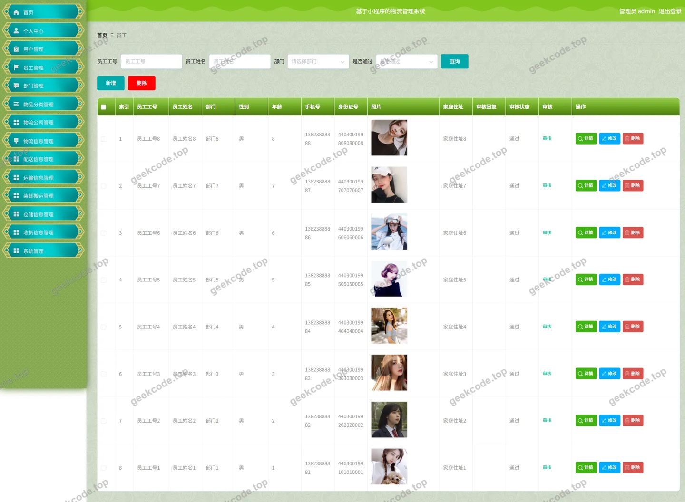</a>

<h4>后台-运输信息</h4>

---

## 获取完整源码

| 项目 | 说明 |
| --- | --- |
| 项目名 | 基于小程序的物流管理系统---论文 |
| 运行截图 | 本文 29 张（站点带水印原图，仓库 `images/` 目录） |
| 完整源码 | [https://geekcode.top/archives/%E5%9F%BA%E4%BA%8E%E5%B0%8F%E7%A8%8B%E5%BA%8F%E7%9A%84%E7%89%A9%E6%B5%81%E7%AE%A1%E7%90%86%E7%B3%BB%E7%BB%9F-%E8%AE%BA%E6%96%87?utm_source=github](https://geekcode.top/archives/%E5%9F%BA%E4%BA%8E%E5%B0%8F%E7%A8%8B%E5%BA%8F%E7%9A%84%E7%89%A9%E6%B5%81%E7%AE%A1%E7%90%86%E7%B3%BB%E7%BB%9F-%E8%AE%BA%E6%96%87?utm_source=github) |
| 咨询微信 | **ir9372**（备注：jingpin-yuanma） |
| 更多项目 | [极客代码 geekcode.top](https://geekcode.top/?utm_source=github) |

> 需要源码、部署、改配置、跑不起来等问题，加微信 ir9372 沟通，说明项目名即可。
